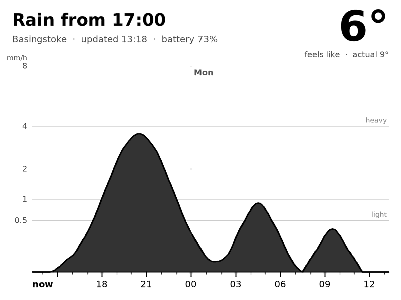

# raindash

A 24-hour rain forecast chart for a jailbroken Kindle Touch, for leaving on a window sill.




A server renders the chart as a PNG every 10 minutes, with a plain-English headline ("Just spitting, dry by 15:00") and a large "feels like" temperature. The Kindle downloads it over plain HTTP and draws it on the screen.
Rendering on the server keeps the Kindle side to a few lines of shell, and gets round the Kindle's outdated TLS
(it can't fetch modern HTTPS).

Forecast data: [Open-Meteo](https://open-meteo.com) (UK Met Office UKV model), CC BY 4.0.

## Server (any Linux box with Python 3)

```sh
apt install -y python3-pil fonts-dejavu-core nginx
python3 server/render.py /var/www/raindash        # writes rain-<location>.png
```

Run it from cron every 10 minutes (`server/raindash.cron`) and serve the folder over HTTP (`server/raindash.nginx`).
Use `--demo` to render made-up data.

Locations go in `server/locations.json` (copy `locations.example.json`). This file is gitignored, so precise
coordinates stay off GitHub. One location is marked `"kindle"`, and that one is also written as `kindle.png`.

Each time the Kindle fetches `kindle.png`, it adds its battery level to the request.
nginx logs these requests to `/var/log/raindash/heartbeat.log`, which shows whether the Kindle is alive.
The next render draws the battery level on the chart, with a warning below 20%.
Rotation and the y-axis scale are set at the top of `render.py`.

## Kindle (Kindle Touch, jailbroken, with KUAL)

1. Set `IMAGE_URL` in `kindle/raindash/config.sh` (normally `http://<server>/kindle.png`).
2. Copy `kindle/raindash` to `extensions/raindash` on the Kindle.
3. KUAL → Rain Dash → **Start dashboard**. Use **Stop dashboard** to stop it.

The scripts must have LF line endings. `.gitattributes` handles this when you clone with git.
